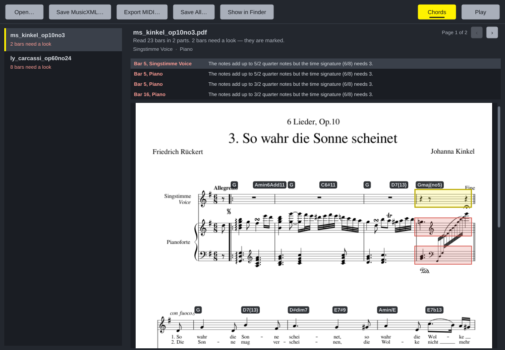

# Accurate Notation Scanner

A Mac app that turns PDF scores into MusicXML - exactly, or not at all.

Drop a PDF on its window. If the score was made on a computer (exported from
Sibelius, Dorico, MuseScore, Finale, LilyPond or any notation program), every
note, rest, clef, key, time signature, tie and tuplet is read from it and
every bar is checked. Save the result as MusicXML and open it in Dorico,
Sibelius, MuseScore, Finale or Noterator.

Scans and handwriting are refused, with a reason. Reading a picture means
guessing, and the guessing is why music scanners are so often wrong.



## Why it can be exact

Other scanners treat every PDF as a photograph and try to recognise shapes
in the pixels. But a PDF made by a notation program is not a picture. Every
notehead, clef and rest in it is a character of a music font, named and
placed to a hundredth of a point; every staff line, stem, beam and barline is
a drawn line. Nothing has to be recognised - only read.

So this app reads what the PDF says is there:

- **Symbols by name.** Modern music fonts (Bravura, Leland, Petaluma,
  Finale Maestro, MuseScore's own - the SMuFL standard) give every symbol a
  fixed code. LilyPond's font names its glyphs. A quarter-note head is a
  quarter-note head; a sharp is a sharp.
- **Positions exactly.** A note's pitch is the line or space its head sits
  on, from the staff lines' own positions, under the clef and key in force.
- **Lines as lines.** Stems, beams, ledger lines and barlines are drawn
  strokes; a stem is told from a barline by the notehead at its end.
- **Then it checks its own work.** Each bar's notes must add up to its time
  signature, each voice must fit, each note must sit on a line or a space,
  every tie must land on the same pitch. Anything that does not check out is
  marked on the page and listed - never quietly "fixed".

## How accurate

Tested on large collections of real music: each piece engraved into a PDF
by MuseScore, read back by the app, and compared note by note with exactly
what was printed (pitch with its spelling, onset, length, tie). Full results
and method: [docs/ACCURACY.md](docs/ACCURACY.md).

| Collection | Pieces | Notes | Exactly right |
| --- | ---: | ---: | ---: |
| OpenScore Lieder (voice and piano) | 1,332 | 1.47 million | 88.9% |
| OpenScore String Quartets | 119 movements | 1.37 million | 96.4% |
| Mozart piano sonatas | 58 movements | 122,000 | 96.4% |
| Beethoven string quartets | 70 movements | 278,000 | 99.4% |
| music21 corpus: 410 Bach chorales, Palestrina, Monteverdi, Trecento, folk tunes, more | 927 | 547,000 | 98.5% |
| **All** | **2,506** | **3.79 million** | **94.0%** |

Most of what is wrong is marked on the page for you to check (79% of wrong
bars in the songs, 43-81% elsewhere). What is not marked is mostly ties: the
notes and rhythms are right, but a slur between two equal notes was read as
a tie or the other way round - they are drawn the same way. Dense piano
writing that passes between the two staves is the other weak spot.

LilyPond's own scores, the whole Mutopia Project (1,473 pieces, 1.35 million
notes, checked against LilyPond's MIDI): 76.7% of notes have the right pitch
in the right order; the median piece is 97.5% right. Large orchestral scores
are where it is weakest.

## What it reads

Notes and chords, rests, dots, ties, slurs, tuplets, grace notes, clefs
(including octave clefs and clef changes), key and time signatures and their
changes, two voices on a staff, grand staves, repeats and first/second
endings (played as written), two-note tremolos, multi-bar rests,
pickup bars, pages printed sideways, accents, staccato, tenuto, fermatas and other articulations,
dynamics, part names, title and composer.

Not yet: lyrics, chord symbols, 8va lines (the bar where one starts is marked),
single-note tremolos, D.C./D.S. jumps, guitar tablature, cross-staff notes, three or more voices on one
staff, and fonts that put music on ordinary letters (old Sibelius Opus and
Finale Maestro scores) - those PDFs are refused rather than misread.

## Installing on a Mac

The app is built automatically on GitHub every time the code changes.

1. Open the repository's **Actions** tab on GitHub, click the latest green
   **Build** run, and download **AccurateNotationScanner-macOS** under
   *Artifacts*. (Once a version is tagged, it is also under **Releases**.)
2. Unzip it and open `AccurateNotationScanner-macOS.dmg`. Drag the app into
   Applications.
3. The first time only, **right-click** it in Applications and choose
   **Open**. macOS asks because the app is not yet signed with an Apple
   Developer certificate. If it says the app is "damaged", see
   [docs/INSTALL-MAC.txt](docs/INSTALL-MAC.txt) - it is one line in Terminal.

It needs a Mac with Apple silicon (M1 or later).

### Or build it on your own Mac

`build-mac.command`, at the top of the code, builds the app on your Mac and
puts it in Applications - the same way as Noterator's. Download it,
double-click it (the first time: right-click, **Open**), and press Return.
It needs [Homebrew](https://brew.sh); it installs everything else itself.

## Using it

| | |
| --- | --- |
| Convert | drop PDFs (or a folder of them) on the window, or **Open…** |
| See what needs a look | choose a file; bars to check are outlined in red, and listed under the page - click one to go to it |
| Save | **Save MusicXML…** for the chosen file; **Save All** puts each next to its PDF |
| Open in Noterator | **Open in Noterator** (shown when Noterator is in Applications) |

There is also a command-line converter, `notation-scan score.pdf`, which
writes `score.musicxml` and lists anything to check.

## For developers

| | |
| --- | --- |
| `Source/Core/` | The reader. No JUCE: builds and tests in seconds. |
| `Source/Core/PdfReader.*` | The only code that talks to MuPDF: glyphs, paths and pictures off each page. |
| `Source/Core/Glyphs.*` | Naming a font character as a SMuFL symbol (SMuFL and LilyPond fonts). |
| `Source/Core/Shapes.*` | Drawn paths as segments (stems, beams, lines) and curves (ties, slurs). |
| `Source/Core/Layout.*` | Staves, systems, parts, barlines. |
| `Source/Core/Reader.*` | Symbols into music, and every bar checked. |
| `Source/Core/MusicXml.*`, `Xml.*` | Writing MusicXML 4.0 (`Xml.*` is Noterator's). |
| `Source/App/` | The JUCE window. |
| `Tests/` | Core tests, including real PDFs read note by note (`Tests/fixtures`). |
| `tools/corpus.py` | The accuracy check: engrave, read back, compare. |

```sh
# core and tests (Ubuntu's MuPDF; leave the option off to build MuPDF from source)
cmake -B build-core -G Ninja -DANS_BUILD_APP=OFF -DANS_SYSTEM_MUPDF=ON && cmake --build build-core && ./build-core/ScannerTests
# the accuracy check (needs mscore3, lilypond and pip's music21)
python3 tools/corpus.py --sets bach,real,random --count 40
```

See [CLAUDE.md](CLAUDE.md) and [docs/ARCHITECTURE.md](docs/ARCHITECTURE.md).

GPL-3.0. MuPDF is AGPL-3.0; the SMuFL glyph names are the W3C Music
Notation Community Group's.
