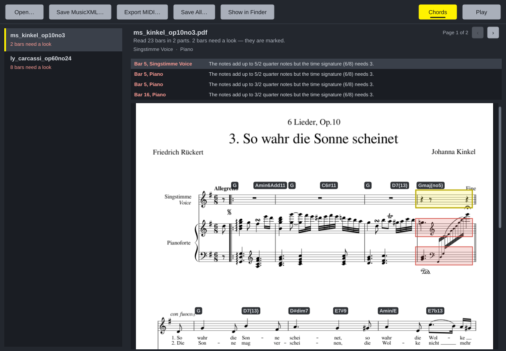
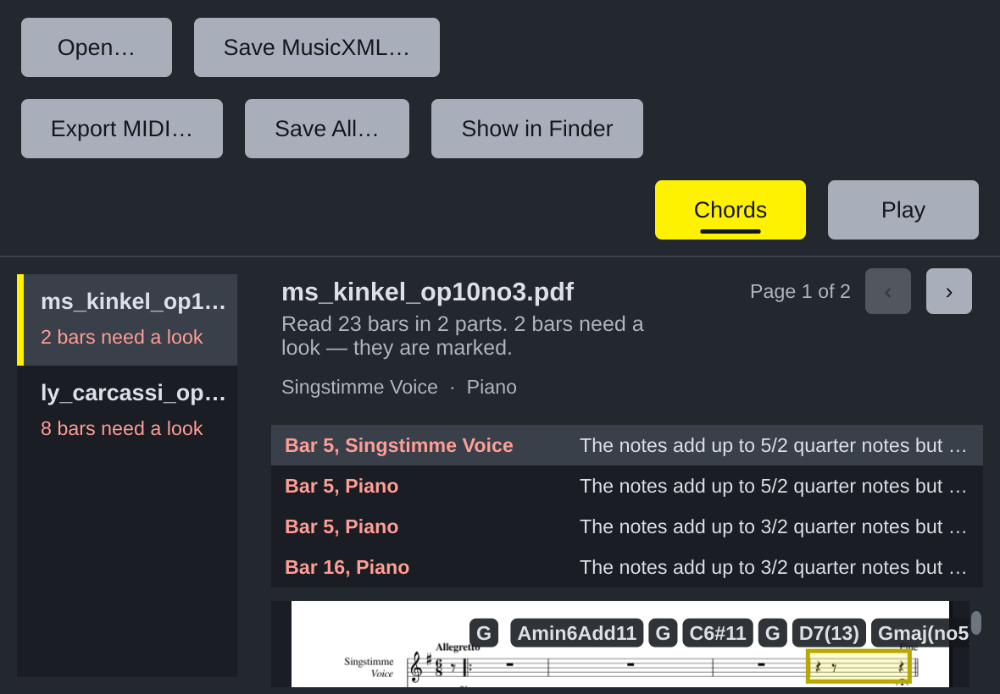

# Review against Apple's Human Interface Guidelines

The window checked against the guidelines as the family applies them: Good
Idea's review (`docs/apple-hig-review.md` and decisions 0030-0031 in
KallumS/Good-Idea) and Noterator's, the family's other JUCE app (its 0048).
The reasons are in [decision 0014](decisions/0014-apples-human-interface-guidelines.md).

## What changed

| Guideline | Before | Now |
| --- | --- | --- |
| **Contrast: text at least 7:1** (Good Idea ACC-10, DRK-07) | The instrument line and a refused file's verdict were written in `#8A919C`, 4.7:1. | Every word is 7:1 or more; `#8A919C` is only an edge. Checked by `Tests/TestTheme.cpp`, which reads the colours from `Theme.h`. |
| **Contrast: things to see and grab 3:1** (ACC-11) | Scroll bar thumb `#585F6B`, 2.6:1. | `#6D7581`, 3.3:1. |
| **Increase Contrast** (Color) | Ignored. | Read from the Mac every 1.5 s (Noterator's `SystemSettings`): secondary text, warnings and rules get stronger. |
| **Larger text, up to 200%** (ACC-06, TYP-16) | One size. | **View → Interface Size**: 100% to 200%, Cmd+= / Cmd+- / Cmd+0, remembered. The smallest window shrinks so 200% fits a laptop. |
| **Wrap, don't crop** (LAY-08, TYP-18) | Fixed toolbar positions: at 200% Chords and Play fell off the edge, "Show in Finder" broke in two, the file name ran over the page count. | The toolbar folds into rows, buttons as wide as their words, 12 points apart; the header grows with its text; the file list narrows; a cut-short row shows its whole text on hover. |
| **Nothing important at the window's bottom edge** (LAY-16) | The list of bars that need a look ran along the bottom. | It sits above the page, under the file's name. |
| **The keyboard alone** (ACC-29, ACC-30) | Clicking a button kept the keyboard on it, so Space pressed it again instead of playing. | Clicking leaves the keys with the window (Noterator's `clicksKeepFocus`); Tab reaches every control, ringed in the text colour; Esc hands the keys back. A menu bar with the Mac's shortcuts: Cmd+O, Cmd+S, Cmd+E, Cmd+Shift+S, Cmd+K, Cmd+[ and Cmd+], Space. |
| **VoiceOver** (ACC-18) | The page arrows read "‹" and "›"; list rows had no names; the window was always "Accurate Notation Scanner". | "Previous Page", "Next Page"; each row is read whole ("ms_kinkel_op10no3: 2 bars need a look", "Bar 5, Piano: The notes add up to…"); the page describes itself; the title names the open score. |
| **Not colour alone** (ACC-15, COL-08) | Chords on was only yellow. | It carries an ink bar under its word too. |
| **Writing** (WRI) | "Save All" asked a question first without an ellipsis; straight apostrophes; a part named "Part 2" where the line above said "Piano"; an unidentified part marked "(?)". | "Save All…"; curly apostrophes; a part's name, else its instrument, everywhere; no "(?)". The empty window says what to do: "Drop PDF scores here, or choose Open…". |
| **Chord labels** (LAY-03) | Labels close together covered each other. | Each starts after the last on its line. |

## Already met

- **Purpose and clarity.** One window for one job; the page is shown as
  printed, with the bars to check outlined and listed.
- **Feedback.** Every file says how it went; Play turns to Stop and the bar
  being played is lit; hover and press states on every button.
- **Familiar Mac parts.** The Mac's own file dialogs and alerts, Cancel
  beside Save, a destructive question worded for what it does.
- **Privacy.** Nothing is sent anywhere; only the interface size and the
  chords switch are kept, in Application Support.
- **Motion.** Nothing animates; the page turns while playing, it does not
  scroll smoothly.

## Not done, or only on a Mac

- Only the names VoiceOver would read were checked, not VoiceOver itself;
  the menu bar and Increase Contrast are Mac-only and were built and run on
  Linux, where both are absent (the Mac CI job does not start).
- The app icon in Apple's layered format needs Icon Composer on a Mac.
- English only; right to left not considered.
